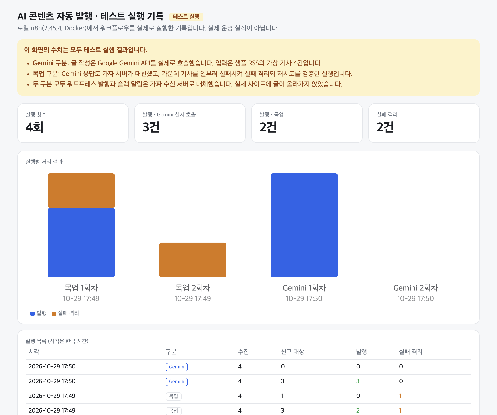

# AI 콘텐츠 자동 발행 파이프라인 (n8n + LLM)

키워드 뉴스 수집 → AI(Gemini) 요약/글 작성 → 워드프레스 발행 → 슬랙 알림까지 사람 손 없이 도는 자동화.
실패 시 재시도, 한 건 실패 격리, 워크플로우 전체 에러 알림까지 포함한 **운영형** 구성입니다.

## 테스트 실행 기록 대시보드
**https://ai-pipeline-dashboard-seven.vercel.app**

로컬 n8n에서 실제로 실행한 기록입니다. **테스트 실행이며 운영 실적이 아닙니다.** 글 작성은 Gemini API를 실제로 호출했고, 워드프레스·슬랙은 가짜 수신 서버로 대체했습니다.



## 구성
| 경로 | 설명 |
|---|---|
| `n8n/ai-content-pipeline.workflow.json` | n8n에 Import → 바로 사용 (10개 노드) |
| `pipeline/run.py` | 같은 흐름의 Python 구현. API 키 없이 `--demo`로 로컬 검증 |
| `dashboard/index.html` | 테스트 실행 기록 대시보드. `dashboard/runs.json`(n8n 실행 기록에서 `extract_runs.py`로 추출)을 읽음. **운영 실적 아님** |
| `fixtures/sample_feed.xml` | 데모용 RSS |
| `mock/server.py` | Gemini·워드프레스·슬랙 목업 서버 (테스트 전용) |
| `n8n/make_test_variant.py` | 외부 서비스 노드를 목업 호출로 바꾼 테스트본 생성 |

## n8n 워크플로우 흐름
`매일 09시` → `RSS 수집`(재시도 3회) → `키워드 필터 + 중복 제거`(Static Data로 발행 이력 유지) → `LLM 요약/작성`(재시도 3회, 실패 시 별도 출력) → `글 포맷 정리` → `워드프레스 발행`(재시도 3회) → `슬랙 완료 알림`
- LLM 실패 건은 `LLM 실패 격리` 출력으로 빠져 슬랙에 알리고 **나머지 건은 계속 처리**
- `에러 트리거` → 워크플로우 전체 실패를 슬랙으로 통보

### 설정
1. n8n에서 Import from file → 위 JSON
2. Credentials: WordPress, Slack 연결 (JSON의 `REPLACE_ME` 교체)
3. 환경변수: `GEMINI_API_KEY`(무료 키, Google AI Studio), 선택 `GEMINI_MODEL`, `RSS_URL`, `KEYWORDS`, `MAX_POSTS`
4. 활성화 전 'Execute workflow'로 1회 테스트

## 로컬 데모
```bash
python3 pipeline/run.py --demo                 # 키 없이 동작
GEMINI_API_KEY=... python3 pipeline/run.py --feed <RSS_URL>
open dashboard/index.html
```

## 목업으로 끝까지 돌려보기 (API 키·계정 불필요)
외부 서비스(Gemini API, 워드프레스, 슬랙)를 로컬 목업 서버로 대체해 **흐름 전체**를 검증합니다. 요약 글은 AI가 쓴 것이 아니라 고정 문구입니다.
```bash
python3 mock/server.py 8100 &                          # 목업 서버 (FAIL_MARK=example.com/a2 처럼 실패시킬 기사 지정, 기본 a4)
python3 -m http.server 8099 --directory fixtures &     # 샘플 RSS
python3 n8n/make_test_variant.py                       # 테스트용 워크플로우 생성
docker run -d --name n8n-portfolio -p 5678:5678 -e N8N_BLOCK_ENV_ACCESS_IN_NODE=false \
  -e RSS_URL=http://host.docker.internal:8099/sample_feed.xml \
  -v n8n_portfolio_data:/home/node/.n8n -v "$PWD/n8n":/import:ro docker.n8n.io/n8nio/n8n
docker exec n8n-portfolio n8n import:workflow --input=/import/ai-content-pipeline.test.workflow.json
docker exec -e N8N_RUNNERS_BROKER_PORT=5780 n8n-portfolio n8n execute --id portfolioMockTest01
cat mock/out/received.jsonl                            # 발행·알림 요청 확인
```
검증 결과(n8n 2.45.4, 목업): 4건 중 키워드 불일치 1건 제외 → 3건 처리. 가운데 기사(a2)를 실패시키면 나머지 2건은 발행·알림되고 a2만 재시도 후 격리 알림. 2회차 실행에서는 발행한 2건을 건너뛰고 실패한 a2만 다시 시도(이력은 발행 성공 후에만 기록). 실행 상태 `success`.
실제 Gemini 호출(`REAL_LLM=1 python3 n8n/make_test_variant.py`, 워드프레스·슬랙은 목업): 3건 모두 한국어 글 생성·발행, 2회차는 전부 중복 건너뜀. 한 번은 `socket hang up`으로 재시도 3회 후 격리됐고 다음 실행에서 정상 처리됨.
> n8n 2.x 는 기본적으로 `$env` 접근을 막습니다. 이 워크플로우를 쓰려면 `N8N_BLOCK_ENV_ACCESS_IN_NODE=false` 가 필요합니다.

> 대시보드의 수치는 로컬에서 돌린 테스트 실행 결과입니다. 실제 운영 수치(발행 건수, 성공률)로 소개하지 마세요. 운영을 시작하면 `extract_runs.py`로 그 실행 기록을 다시 뽑아 교체하세요.
